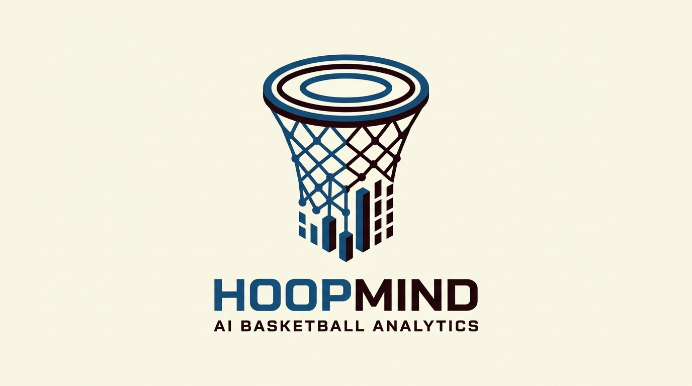

<p align="center"></p>

# HoopMind · Big Data + IA

Predicción del ganador de un partido de la NBA (clasificación) y de los puntos totales del partido (regresión), usando solo datos de equipo y partido (sin datos de jugadores). Hadoop (HDFS + Hive, sin PySpark), MLflow y FastAPI.

## Estructura
- `hadoop/`: Docker Compose con HDFS, YARN y Hive.
- `scripts/`: ingesta a HDFS (`ingest_raw.sh`) y ensuciado reproducible (`ensuciar.py`).
- `notebooks/`: EDA y modelos.
- `api/`: API FastAPI.
- `docs/`: informe (`HoopMind_Plan_v1.2.pdf`), Gantt y presupuesto, paleta de marca, capturas de evidencias.

## Puesta en marcha (Hadoop)
```bash
cd hadoop && docker compose up -d
docker exec namenode hdfs dfs -ls /      # evidencia: HDFS operativo
```

## Ingesta en bruto
Requiere `~/.kaggle/kaggle.json`.
```bash
./scripts/ingest_raw.sh eoinamoore/historical-nba-data-and-player-box-scores 2026-11-17
```

## Estado
Entrega 1 en curso (18 nov). Ver `docs/`. Identidad visual en `docs/PALETA_HOOPMIND.md`.
